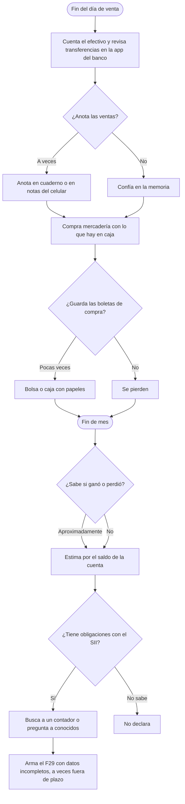
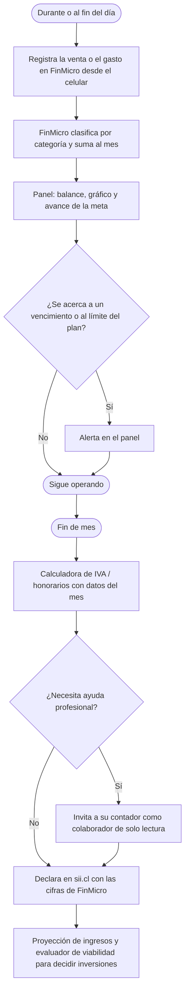

# Modelamiento de procesos

**Actividades 3.1 (AS-IS) y 3.2 (TO-BE)** · Responsable: Marcelo · Aprueba: Carlos · Semanas 5–6

> El AS-IS se construyó a partir del perfil del microempresario informal descrito en el
> informe. **Debe contrastarse con los resultados de las entrevistas (actividad 2.5)**:
> si el trabajo de campo muestra otro flujo, se ajusta este diagrama y la pila de producto.

## 3.1 Proceso actual (AS-IS): control financiero de un microempresario informal

**Problemas observados**

| # | Problema | Consecuencia |
|---|---|---|
| P1 | Registro irregular de ventas y gastos | No conoce su utilidad real |
| P2 | Mezcla de dinero personal y del negocio | Decisiones de compra sin información |
| P3 | Respaldos de compras perdidos | Pierde crédito fiscal de IVA |
| P4 | Desconocimiento de tasas y plazos | Multas, intereses o informalidad por temor |
| P5 | Dependencia de un tercero para cualquier cálculo | Costo y demora |
| P6 | Sin proyección | No sabe si puede invertir o endeudarse |

## 3.2 Proceso propuesto (TO-BE): con FinMicro

**Cómo responde el TO-BE a cada problema**

| Problema | Respuesta | RF |
|---|---|---|
| P1 | Registro en menos de un minuto, desde el celular | RF-08, RNF-10, RNF-11 |
| P2 | El panel muestra solo los movimientos del negocio | RF-14, RF-33 |
| P3 | Categorías marcadas como afectas a IVA; importación de compras | RF-09, RF-12, RF-22 |
| P4 | Calculadoras con tasas vigentes y calendario de vencimientos | RF-20, RF-21, RF-23 |
| P5 | El contador entra como colaborador, sin compartir claves | RF-06 |
| P6 | Proyección de ingresos y VAN/TIR | RF-34, RF-35 |
