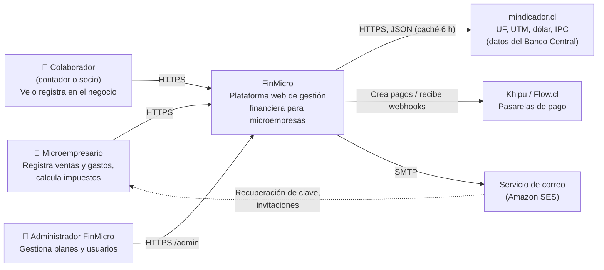
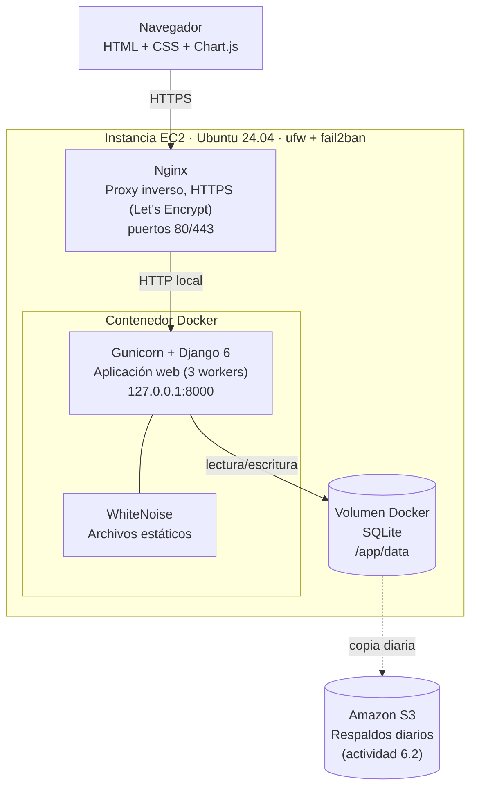
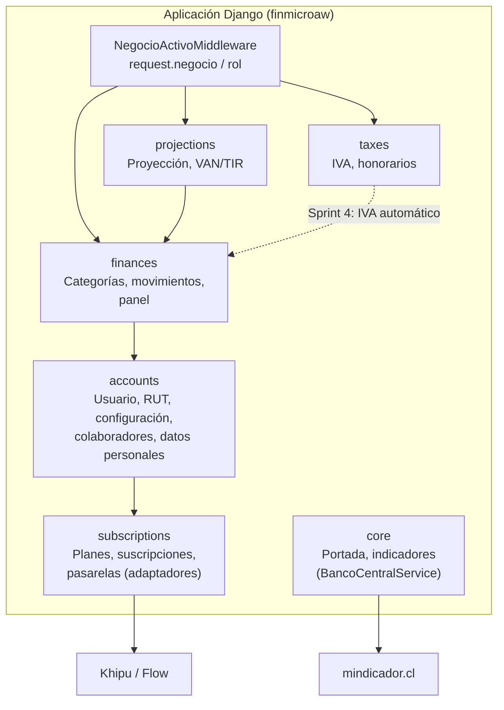

# Arquitectura (modelo C4) y stack tecnológico

**Actividades 3.3 y 3.5** · Responsable: Danilo · Aprueba: Carlos · Semanas 6–7

Arquitectura MVP: **monolito modular en Django sobre una sola instancia EC2**, empaquetado
en Docker. Se eligió por costo (cabe en el presupuesto de la actividad 6.0) y porque un
equipo de cuatro personas puede operarlo. El camino para crecer está en
[08_plan_escalamiento.md](08_plan_escalamiento.md).

## Nivel 1 — Contexto

## Nivel 2 — Contenedores

## Nivel 3 — Componentes de la aplicación Django

**Decisiones de diseño**

| Decisión | Motivo |
|---|---|
| Una app Django por dominio | Límites claros; cada app tiene sus modelos, vistas, servicios y pruebas. |
| Cálculos en `services.py`, sin dependencias de Django | Se prueban con `SimpleTestCase`, sin base de datos (rápido, aislado). |
| Aislación por `request.negocio` | Multi-tenant lógico: toda consulta filtra por el negocio activo (RNF-03). |
| Patrón adaptador para pagos e indicadores | Cambiar Khipu/Flow o pasar a la API oficial del Banco Central no toca las vistas. |
| SQLite en el MVP | Cero administración y respaldo como archivo. Ver límites y migración en el plan de escalamiento. |

## Stack tecnológico (actividad 3.5)

| Capa | Tecnología | Versión | Por qué |
|---|---|---|---|
| Lenguaje | Python | 3.13 (Docker) | El equipo lo domina; ecosistema financiero y de IA. |
| Framework | Django | 6.0 | Autenticación, admin, ORM, migraciones, protección CSRF/XSS incluidas. |
| Servidor de aplicación | Gunicorn | 23 | Estándar para Django en producción. |
| Estáticos | WhiteNoise | 6.9 | Sirve CSS sin configurar Nginx para ello. |
| Base de datos | SQLite → PostgreSQL | — | Ver plan de escalamiento. |
| Frontend | Plantillas Django + CSS propio + Chart.js 4 | — | Sin build de JavaScript; liviano en celulares de gama baja. |
| Contenedores | Docker + Docker Compose | — | Mismo entorno en desarrollo, CI y producción. |
| Proxy / TLS | Nginx + Let's Encrypt (certbot) | — | HTTPS gratuito y renovación automática. |
| Infraestructura | AWS EC2 (t3.micro o t3.small), S3, SES, Budgets | — | Plan gratuito inicial; ver actividad 6.0. |
| CI | GitHub Actions | — | Integrado al repositorio. |
| Indicadores | mindicador.cl | — | Gratis y sin credenciales; misma fuente que el Banco Central. |
| Pagos | Khipu, Flow.cl | — | Pasarelas locales (informe, PESTEL). |
