# Modelo de datos

**Actividad 3.4** · Responsable: Marcelo · Aprueba: Danilo · Semana 7

Refleja los modelos implementados en el repositorio al 13-11-2026 (sprints 1 a 6). La
tabla del final resume qué agregó cada sprint. Imagen para anexos: [diagramas/modelo_de_datos.png](diagramas/modelo_de_datos.png).

```mermaid
erDiagram
    USUARIO ||--o{ MOVIMIENTO : "registra (negocio)"
    USUARIO ||--o{ CATEGORIA : "crea (propias)"
    USUARIO ||--o{ SUSCRIPCION : "tiene"
    USUARIO ||--o{ COLABORACION : "otorga (propietario)"
    USUARIO |o--o{ COLABORACION : "recibe (colaborador)"
    PLAN ||--o{ SUSCRIPCION : "define"
    CATEGORIA ||--o{ MOVIMIENTO : "clasifica"
    USUARIO ||--o{ PRODUCTO : "vende (negocio)"
    PRODUCTO |o--o{ MOVIMIENTO : "venta desde catálogo"
    USUARIO ||--o{ ALERTA : "recibe (negocio)"
    USUARIO ||--o{ CONSENTIMIENTO : "acepta"
    DOCUMENTO_LEGAL ||--o{ CONSENTIMIENTO : "versión aceptada"
    USUARIO |o--o{ REGISTRO_AUDITORIA : "acciones sensibles"
    USUARIO ||--o{ CONSULTA_ASISTENTE : "pregunta (negocio)"

    USUARIO {
        bigint id PK
        varchar username UK
        varchar email
        varchar rut UK "12345678-9, DV validado"
        varchar nombre_negocio
        char tipo_negocio "FL CO GA SE AR OT"
        varchar telefono
        varchar comuna
        char regimen_tributario "SI PP PT RP RG"
        bool afecto_iva
        bool emite_boletas_honorarios
        int meta_ventas_mensual "nullable"
        int saldo_caja_inicial
        datetime fecha_registro
    }
    COLABORACION {
        bigint id PK
        bigint propietario_id FK
        bigint colaborador_id FK "null hasta aceptar"
        varchar email "UK con propietario"
        varchar rol "lector | editor"
        varchar estado "pendiente | aceptada"
        uuid token UK
        datetime creada_en
    }
    PLAN {
        bigint id PK
        varchar codigo UK "basico | premium"
        varchar nombre
        int precio_mensual_clp
        bool con_publicidad
        int limite_movimientos_mensuales "null = ilimitado"
        bool incluye_proyecciones
        bool incluye_evaluador_viabilidad
        text descripcion
        bool activo
    }
    SUSCRIPCION {
        bigint id PK
        bigint usuario_id FK
        bigint plan_id FK "PROTECT"
        varchar estado "pendiente activa cancelada vencida"
        varchar metodo_pago "ninguno khipu flow"
        varchar referencia_pago
        datetime fecha_inicio
        datetime fecha_fin
        datetime creada_en
    }
    CATEGORIA {
        bigint id PK
        varchar nombre
        varchar tipo "ingreso | gasto"
        bigint usuario_id FK "null = del sistema"
        bool es_gravable_iva
        varchar naturaleza "fijo | variable | vacío"
    }
    MOVIMIENTO {
        bigint id PK
        bigint usuario_id FK "dueño del negocio"
        bigint categoria_id FK "PROTECT"
        bigint producto_id FK "nullable, SET_NULL"
        int cantidad "nullable"
        varchar tipo "= categoria.tipo"
        decimal monto "12,2 · mínimo 1"
        date fecha
        varchar descripcion
        datetime creado_en
    }
    PRODUCTO {
        bigint id PK
        bigint usuario_id FK
        varchar nombre "UK con usuario"
        decimal precio
        bool afecto_iva
        bool activo
    }
    TASA_TRIBUTARIA {
        bigint id PK
        varchar codigo "IVA | RET_HON"
        decimal valor
        date vigente_desde "UK con codigo"
        date vigente_hasta "nullable"
        varchar fuente
    }
    FERIADO {
        bigint id PK
        date fecha UK
        varchar nombre
    }
    ALERTA {
        bigint id PK
        bigint negocio_id FK
        varchar codigo "UK con negocio"
        varchar severidad
        varchar mensaje
        bool leida
    }
    DOCUMENTO_LEGAL {
        bigint id PK
        varchar tipo "terminos | privacidad"
        varchar version "UK con tipo"
        text contenido
        char huella "SHA-256"
        datetime vigente_desde
    }
    CONSENTIMIENTO {
        bigint id PK
        bigint usuario_id FK
        bigint documento_id FK "PROTECT"
        datetime aceptado_en
        inet ip
    }
    REGISTRO_AUDITORIA {
        bigint id PK
        bigint usuario_id FK "SET_NULL"
        varchar nombre_usuario
        varchar accion
        varchar detalle
        inet ip
        datetime creado_en
    }
    CONSULTA_ASISTENTE {
        bigint id PK
        bigint negocio_id FK
        varchar pregunta
        text respuesta
        datetime creada_en
    }
```

## Restricciones e índices

| Tabla | Restricción | Motivo |
|---|---|---|
| Usuario | `rut` único, `username` único | Un RUT = un negocio (RN-01) |
| Colaboracion | único (`propietario`, `email`) | No duplicar invitaciones |
| Colaboracion | `token` único (UUID4) | Enlace de invitación no adivinable |
| Categoria | único (`nombre`, `tipo`, `usuario`) | Sin categorías repetidas por negocio |
| Movimiento | índice (`usuario`, `fecha`) | Consultas por mes del panel y los filtros |
| Movimiento → Categoria | `PROTECT` | No se borra una categoría con movimientos |
| Suscripcion → Plan | `PROTECT` | No se borra un plan con historial |

## Decisiones

- **El negocio es el usuario dueño.** No existe una tabla `Negocio` separada: en el MVP un usuario tiene un solo negocio. Los colaboradores acceden mediante `Colaboracion` y sus registros quedan a nombre del dueño. Si se requiere que una persona tenga varios negocios propios, se introduce `Negocio` y se migra `usuario_id` → `negocio_id` (cambio acotado gracias a `request.negocio`).
- **`Movimiento.tipo` se duplica desde la categoría** para filtrar sin JOIN; la consistencia se garantiza en `clean()` (RN-07).
- **Montos en `DECIMAL`**, nunca en coma flotante.

## Entidades agregadas en los sprints 2 a 6 (noviembre 2026)

| Sprint / RF | Entidad o campo | Campos principales | Restricciones |
|---|---|---|---|
| S2 · RF-11 | `Producto` | usuario (negocio), nombre, precio, afecto_iva, activo | único (usuario, nombre) |
| S2 · RF-11 | `Movimiento` + | producto (FK opcional, `SET_NULL`), cantidad | solo ingresos llevan producto (RN-19) |
| S3 · RF-16 | `Usuario` + | saldo_caja_inicial | entero, por defecto 0 |
| S3 · RF-19 | `Categoria` + | naturaleza (`fijo` / `variable` / vacío) | vacío en categorías de ingreso |
| S4 · RF-25 | `TasaTributaria` | codigo (IVA, RET_HON), valor, vigente_desde, vigente_hasta, fuente | único (codigo, vigente_desde) |
| S4 · RF-23 | `Feriado` | fecha, nombre | fecha única |
| S4 · RF-24 | `Alerta` (app `core`) | negocio, codigo, severidad, mensaje, enlace, leida | único (negocio, codigo) |
| S5 · RF-29 | `DocumentoLegal` | tipo, version, contenido, huella SHA-256, vigente_desde | único (tipo, version); no editable |
| S5 · RF-29 | `Consentimiento` | usuario, documento (`PROTECT`), aceptado_en, ip | único (usuario, documento) |
| S5 · RF-32 | `RegistroAuditoria` (app `core`) | usuario (`SET_NULL`), nombre_usuario, accion, detalle, ip, creado_en | solo se agrega (RN-30) |
| S6 · RF-37 | `ConsultaAsistente` (app `core`) | negocio, pregunta, respuesta, creada_en | se borra con la cuenta |

Cargas iniciales por migración: categorías del sistema con su naturaleza (`finances` 0004), tasas y
feriados 2026–2027 (`taxes` 0002) y la versión 1.0 de los documentos legales (`accounts` 0005).
