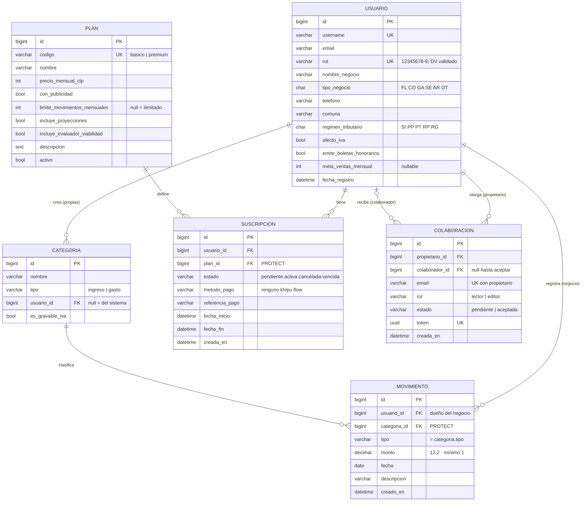

# Modelo de datos

**Actividad 3.4** · Responsable: Marcelo · Aprueba: Danilo · Semana 7

Refleja los modelos implementados en el repositorio al cierre del Sprint 1. Las
entidades de sprints futuros aparecen al final como propuesta.

## Restricciones e índices

| Tabla | Restricción | Motivo |
|---|---|---|
| Usuario | `rut` único, `username` único | Un RUT = un negocio (RN-01) |
| Colaboracion | único (`propietario`, `email`) | No duplicar invitaciones |
| Colaboracion | `token` único (UUID4) | Enlace de invitación no adivinable |
| Categoria | único (`nombre`, `tipo`, `usuario`) | Sin categorías repetidas por negocio |
| Movimiento | índice (`usuario`, `fecha`) | Consultas por mes del panel y los filtros |
| Movimiento → Categoria | `PROTECT` | No se borra una categoría con movimientos |
| Suscripcion → Plan | `PROTECT` | No se borra un plan con historial |

## Decisiones

- **El negocio es el usuario dueño.** No existe una tabla `Negocio` separada: en el MVP un usuario tiene un solo negocio. Los colaboradores acceden mediante `Colaboracion` y sus registros quedan a nombre del dueño. Si se requiere que una persona tenga varios negocios propios, se introduce `Negocio` y se migra `usuario_id` → `negocio_id` (cambio acotado gracias a `request.negocio`).
- **`Movimiento.tipo` se duplica desde la categoría** para filtrar sin JOIN; la consistencia se garantiza en `clean()` (RN-07).
- **Montos en `DECIMAL`**, nunca en coma flotante.

## Entidades propuestas para sprints futuros

| Sprint | Entidad | Campos principales |
|---|---|---|
| 2 | `Producto` | negocio, nombre, precio, afecto_iva, activo |
| 2 | `Movimiento` + | producto (FK opcional), cantidad |
| 3 | `Categoria` + | naturaleza (fijo / variable) |
| 4 | `TasaTributaria` | impuesto, año, tasa, vigente_desde |
| 4 | `Alerta` | negocio, tipo, mensaje, fecha, leída |
| 5 | `Consentimiento` | usuario, documento, versión, fecha, IP |
| 5 | `RegistroAuditoria` | usuario, acción, objeto, fecha, IP |
